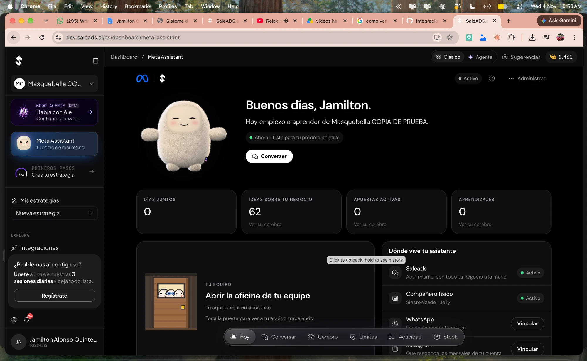
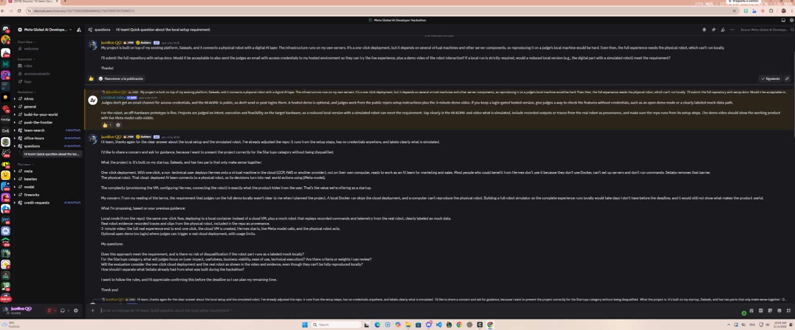
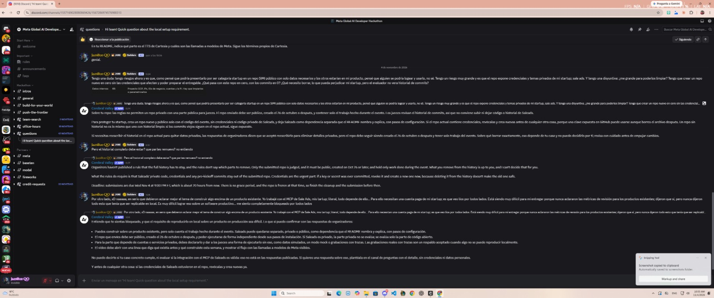
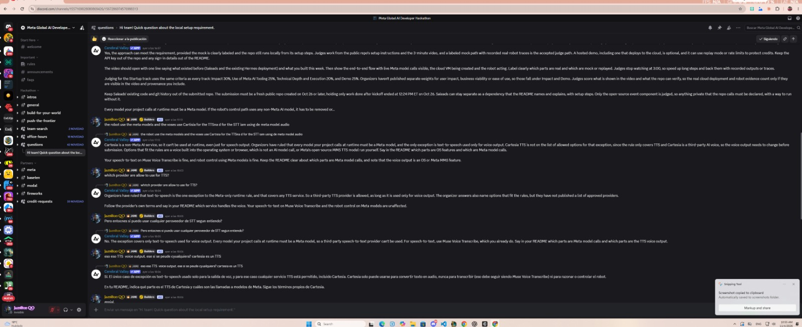

# Ale + Jolly

An AI marketing team with a body, built on Meta models. **Ale** is a marketing partner for small businesses: it reads the business, researches the market, proposes and measures campaigns, and learns with every conversation, with a team of agents behind it. **Jolly** is Ale's body: a small robot with a face, ears, a voice and an eye that counts products on a shelf.

## Why this repo is a slim version

The full, productive solution is **[`ale-runtime/`](ale-runtime/)**. It runs on our own environments: SaleADS (`dev.saleads.ai`), a one-click deploy that creates a cloud VM with Hermes for each user, and Jolly, the physical robot on a Raspberry Pi 5. The demo video was recorded there.



A judge can't reproduce that stack: it needs SaleADS accounts, a cloud project and the physical robot. We asked the organizers. Their answer: a reduced version that runs locally, with every simulated part clearly labeled, meets the requirement, and recorded traces from the real robot are accepted as evidence.





So this repo runs the real `ale-runtime` source, the real web app and real Meta model calls on your computer. Only what a judge can't have is replaced by local stand-ins: the cloud (`cloud-sim/`), SaleADS (`saleads-sim/`) and the robot's body (`jolly-sim/`). What is real, what is simulated and what we changed for it: [`docs/SLIM-VERSION.md`](docs/SLIM-VERSION.md).

## Meta models

Every model call at runtime is to Meta, with your own key:

| Model | What it does |
|---|---|
| **Muse Spark** (`muse-spark-1.3-contributor`) | Ale and its team of agents, including the memory curator that fills the business brain |
| **Muse Spark with web search** | The researcher agent's market research, with sources |
| **Muse Voice Transcribe** (`muse-voice-transcribe-1.0`) | Jolly's ears, in real time |
| **SAM 3.1** (`sam-3.1`) | Jolly's eye: counts the products on the shelf |
| **Muse Image** (`muse-image-1.0`) | The example shelf photos Jolly's eye uses when there is no camera |

Jolly's voice is the one exception allowed by the organizers: Cartesia if you add a key, otherwise your computer's own voice.

## Run it

You need Docker and a Meta API key. On Windows, use Git Bash.

```bash
git clone -c core.longpaths=true <this repo> ale-jolly
cd ale-jolly/local
./demo.sh up            # asks for your Meta key once; first run takes several minutes
./demo.sh meta-check    # optional: one real call to each Meta model above
```

Open `http://localhost:3000` and click «Activar mi asistente». Then follow the end-to-end guide: [`docs/E2E-GUIDE.md`](docs/E2E-GUIDE.md).

With an AI coding agent (Claude Code, Codex, Cursor…): open this repo and ask it to follow [`AGENTS.md`](AGENTS.md).

## Reading order

1. This README: what it is and why it is a slim version.
2. [`docs/SLIM-VERSION.md`](docs/SLIM-VERSION.md): real vs simulated, the robot and its pairing.
3. [`docs/E2E-GUIDE.md`](docs/E2E-GUIDE.md): try the whole product step by step.
4. [`ale-runtime/README.md`](ale-runtime/README.md): the productive solution and how it deploys.

## Layout

| Folder | What lives there |
|---|---|
| `ale-runtime/` | **The productive solution**: Ale's control service, the business brain, the agents' skills, the VM's startup script and the robot's code |
| `front/` | The Meta Assistant web app (Hoy, Conversar, Cerebro, Límites, Actividad, Stock, team office, robot pairing) |
| `local/` | `docker-compose.yml`, `.env.example` and `demo.sh` (`doctor`, `up`, `meta-check`, `down`, `reset`, `logs`) |
| `cloud-sim/` | Local stand-in for the cloud: the Compute API the one-click deploy calls, so each assistant gets a local Hermes container instead of a cloud VM |
| `saleads-sim/` | Local stand-in for SaleADS: its MCP tools and sign-in, with demo data, no SaleADS account needed |
| `jolly-sim/` | Jolly on your computer (face, voice, eye), plus replays of traces from the real robot |
| `mini-muse/` | Jolly's 3D-printable body, to print and assemble it |
| `evidence/` | Recorded traces, photos and logs from the real robot and the real cloud deployment |

## Known limitations of the local version

- A count that Stock blocked because Jolly was closed doesn't resume by itself when Jolly comes back: ask Jolly again.
- Locally, Stock's vision check can't open the shelf photo (the model runs at Meta and can't reach your computer); SAM's count and the card are not affected.
- The first ideas in **Cerebro** show up 20–30 minutes after activation, once the researcher's first study is done.
- Publishing a landing and the full goal → campaign cycle depend on SaleADS services that `saleads-sim` only imitates in part.
