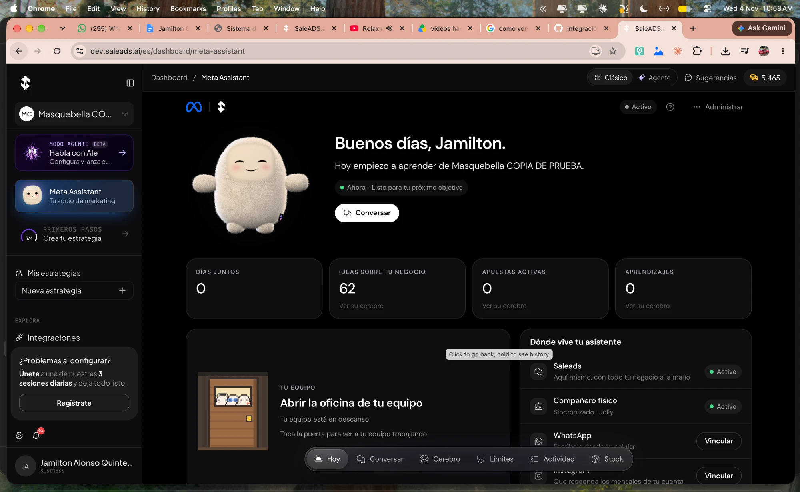
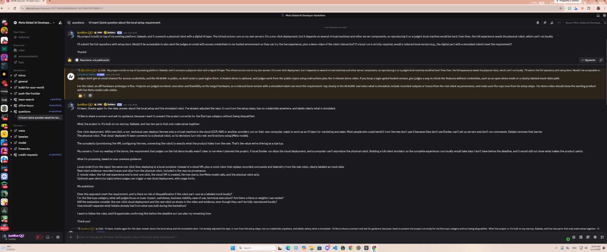
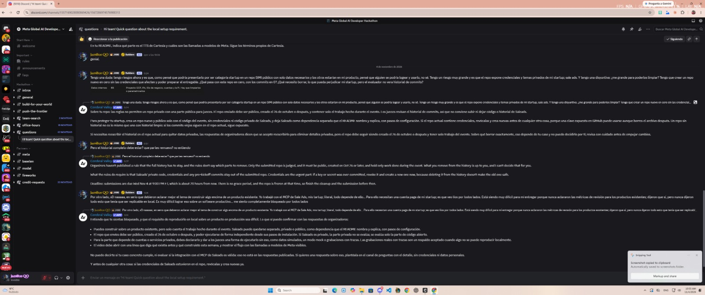
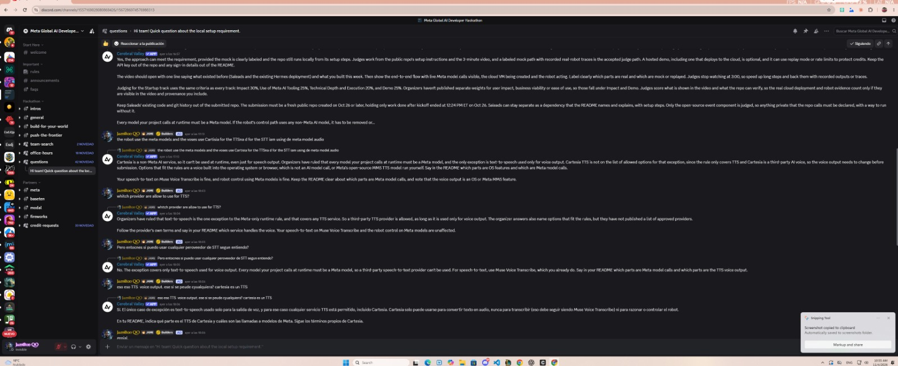

# Slim version: run Ale + Jolly on your own computer

## Why there is a slim version

Ale + Jolly runs in production on our own environments: SaleADS (`dev.saleads.ai`), a one-click deploy that creates a cloud VM with Hermes for each user, and Jolly, the physical robot. **The demo video was recorded there.**



The rules ask that judges can run the submitted repo from its setup steps. The production stack needs SaleADS accounts, a cloud project and the physical robot, so a judge can't reproduce it. We asked the organizers. Their answer was that a reduced local version, with every simulated part clearly labeled, meets the requirement, and that recorded traces from the real robot are accepted as evidence.





## What runs and what is simulated

| Part | In production (video) | In the slim version |
|---|---|---|
| Ale's control service | `ale-runtime` on our servers | **The same `ale-runtime` source**, built from [`ale-runtime/`](../ale-runtime) |
| AI models | Meta: Muse Spark (also with web search), Muse Voice Transcribe, SAM 3.1, Muse Image | **The same Meta models**, with your own Meta API key (`./demo.sh meta-check` tests each one) |
| One-click deploy | Creates a cloud VM with Hermes | Creates a local Docker container that behaves like that VM (`cloud-sim/`) |
| SaleADS | Real accounts, MCP tools, landings | `saleads-sim/`: same protocols, demo business data, no account needed |
| Web app | Meta Assistant inside SaleADS | `front/`: the same Meta Assistant screens |
| Jolly | The physical robot | `jolly-sim/`: Jolly on your computer (mic and camera), or replay of real-robot traces |
| Jolly's voice | Cartesia TTS | Cartesia TTS if you give a key; otherwise your OS voice |

The productive solution shown in the video is [`ale-runtime/`](../ale-runtime). The slim version runs it as is, with these differences:

- **Settings for local timing**, whose defaults keep the production behavior: a shorter retry wait (`ORQA_SYNC_RETRY_AFTER_MS`), the memory curator every 5 minutes instead of every 3 hours (`SALEADS_MEMORY_RECONCILE_EVERY`, set by `cloud-sim`), and a native build platform (`BUILD_PLATFORM`).
- **Fixes found while testing this version end to end**, which also apply to production:
  - the memory curator's tool lists the ontology's types, so it no longer invents types the brain rejects;
  - the brain validates a whole curation batch before writing any of it;
  - Stock takes the shelf photo and recognizes the product even when the owner doesn't name it, and Ale never asks the owner for a photo to count;
  - the instructions for Jolly's spoken replies list every required field.
- **Jolly's voice without Cartesia** uses the computer's own voice on macOS, Windows and Linux (`jolly-sim/`).

To deploy the production version yourself you need SaleADS infrastructure; see "Deployment requirements" in [`ale-runtime/README.md`](../ale-runtime/README.md).

## Jolly, the robot

| What | Where |
|---|---|
| Jolly on your laptop (face, voice, eye with SAM, pairing, replay) | [`jolly-sim/README.md`](../jolly-sim/README.md) |
| The real robot's code: voice and Muse Voice Transcribe, face, eye, arms | [`ale-runtime/robot/`](../ale-runtime/robot/) |
| Install it on a Raspberry Pi 5 from a blank SD card, start it and pair it | [`ale-runtime/robot/ale-robot/README.md`](../ale-runtime/robot/ale-robot/README.md) and [`PI.md`](../ale-runtime/robot/ale-robot/PI.md) |
| Print and assemble its body | [`mini-muse/README.md`](../mini-muse/README.md) |
| Recordings, photos and traces from the real robot | [`evidence/`](../evidence/) |

**How pairing works.** Jolly starts unpaired and its face shows a short code. The owner types it in the web app («Compañero físico» → «Sincronizar»). ale-runtime then gives the robot its own device credential, which stays on the robot. From then on Jolly talks to Ale only through the robot channel of ale-runtime, and only sends text: audio is transcribed on the robot with Muse Voice Transcribe, Ale reasons with Muse Spark, and when Ale asks for a count the robot takes a photo and SAM counts it.

## Run it

You need Docker Desktop (or Docker Engine with Compose v2), `openssl` and a **Meta API key**. Nothing else: no SaleADS account, no cloud account, no login.

```bash
git clone -c core.longpaths=true <this repo> ale-jolly
cd ale-jolly/local
./demo.sh doctor
./demo.sh up
```

1. `./demo.sh doctor` checks Docker, ports and the source. Fix each ✗ as it says. If port 3000 is busy, prefix the commands with `FRONT_PORT=3100`.
2. `./demo.sh up` asks for your Meta API key once, creates local certificates and `local/.env` (both stay on your machine) and starts everything. The first run builds the images and takes several minutes.
3. Open `http://localhost:3000`. You are signed in as the demo owner of «Masquebella (demo)».
4. Click «Activar mi asistente». When the home shows «Activo», a container `vm-sa-assistant-…` is running: that is your assistant's "VM". The first time takes about 7 minutes.
5. In **Conversar**, write to Ale. It answers with Muse Spark.
6. Optional, Jolly: from the repo root run `jolly-sim/start.sh`. Jolly's face shows a pairing code; in the web app open **Compañero físico** and enter it. Without a mic or camera, use `jolly-sim/start.sh --replay` to play a trace recorded from the real robot.

Stop with `./demo.sh down`. Start over from zero with `./demo.sh reset`.

Using an AI coding agent? Ask it to follow [`AGENTS.md`](../AGENTS.md); it has the same steps with a check for each one and a troubleshooting table.
